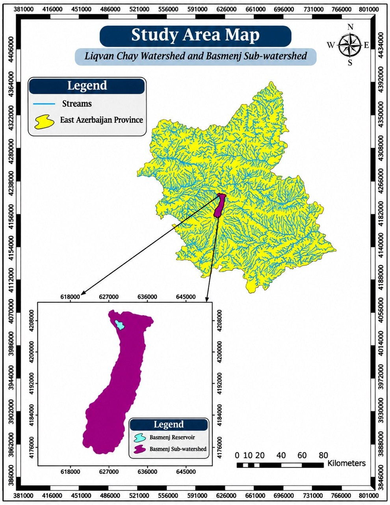
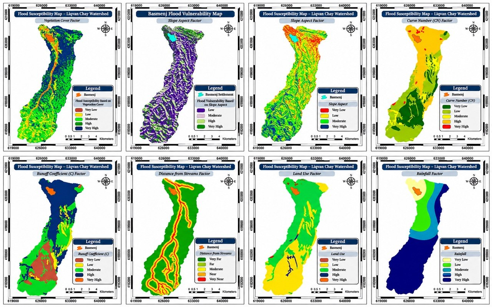
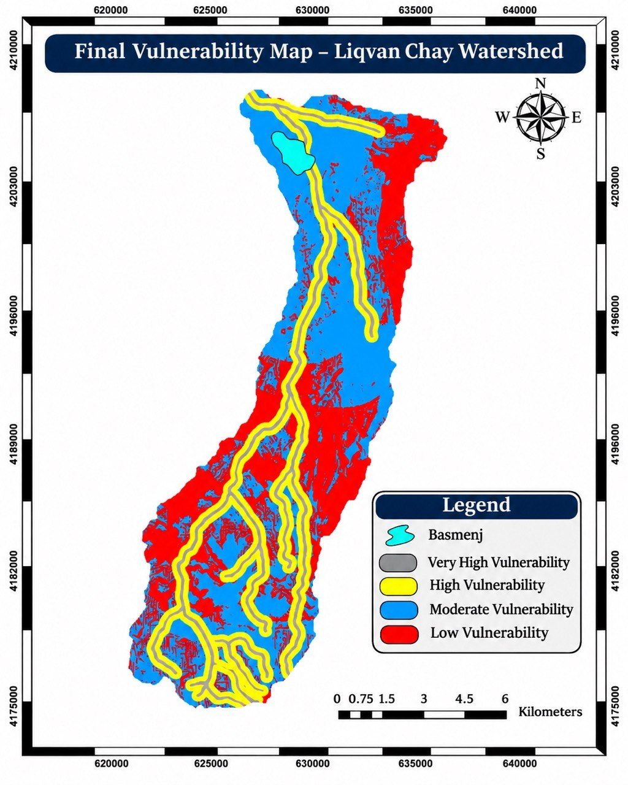

# GIS-Based Flood Hazard Mapping | Liqvan Chay Watershed

**GIS & Remote Sensing | Environmental Hazard Assessment | Spatial Analysis**
 
**Tools:** ArcGIS 10.1, ArcHydro, ENVI, Landsat 8, AHP

## Project Overview

This project focuses on identifying and mapping flood-prone areas in Basmenj Plain, Iran, using Geographic Information Systems (GIS), remote sensing, and multi-criteria spatial analysis.

Environmental, hydrological, and topographical datasets were integrated to assess flood susceptibility and identify areas with different levels of potential flood hazard.

The results provide spatial information to support environmental planning, land-use management, and disaster risk reduction.

## Project Objectives

- Identify and map flood-prone areas.
- Analyze environmental factors influencing flood susceptibility.
- Apply GIS-based multi-criteria analysis to evaluate flood hazard levels.
- Produce thematic maps and a final flood hazard zoning map.
- Support planning and environmental decision-making.

## Data and Methodology

The analysis incorporated ten environmental criteria:

1. Rainfall
2. Distance from drainage networks
3. Slope
4. Slope aspect
5. Elevation
6. Lithology
7. Runoff coefficient
8. Curve Number (CN)
9. Vegetation density (NDVI)
10. Land use

### GIS Analysis Workflow

**1. Spatial Data Preparation**

Prepared environmental, hydrological, topographical, and satellite-derived datasets for spatial analysis.

**2. Thematic Mapping**

Developed thematic GIS layers representing the environmental characteristics influencing flood susceptibility.

**3. Remote Sensing Analysis**

Used Landsat 8 OLI imagery and ENVI to derive vegetation information, including the Normalized Difference Vegetation Index (NDVI).

**4. Multi-Criteria Analysis (AHP)**

Applied the Analytic Hierarchy Process (AHP) to determine the relative importance of flood-related criteria through pairwise comparisons.

**5. Weighted Overlay Analysis**

Reclassified and integrated the thematic raster layers using GIS-based weighted overlay techniques to generate a composite flood susceptibility assessment.

**6. Flood Hazard Zoning**

Classified the analysis results into four flood susceptibility levels:

- Very High
- High
- Moderate
- Low

Produced the final flood hazard zoning map to visualize the spatial distribution of flood-prone areas.

## Key Findings

The analysis identified varying levels of flood susceptibility across the study area.

Distance from drainage networks and rainfall were identified as the most influential factors affecting flood susceptibility.

The resulting hazard zoning map highlights areas requiring greater attention in environmental planning and flood hazard management.

## Project Deliverables

- Final flood hazard zoning map
- Environmental criteria maps
- GIS-based multi-criteria assessment
- Spatial analysis and cartographic outputs

## Technical Skills Demonstrated

- GIS-based environmental hazard modelling
- Spatial data preparation and integration
- Raster analysis and reclassification
- Analytic Hierarchy Process (AHP)
- Weighted overlay analysis
- Remote sensing and NDVI
- Flood susceptibility mapping
- Environmental planning and geospatial visualization

## Project Limitations

This project assesses relative flood susceptibility using GIS-based multi-criteria analysis rather than simulating flood depth or specific flood events.

The results reflect the environmental datasets and modelling approach used at the time of the analysis.

**Author:** Mahsa Baghi  
GIS & Remote Sensing Specialist
## Project Maps

### 1. Study Area Map

### 2. Environmental Factors Analysis

### 3. Final Flood Vulnerability Map

